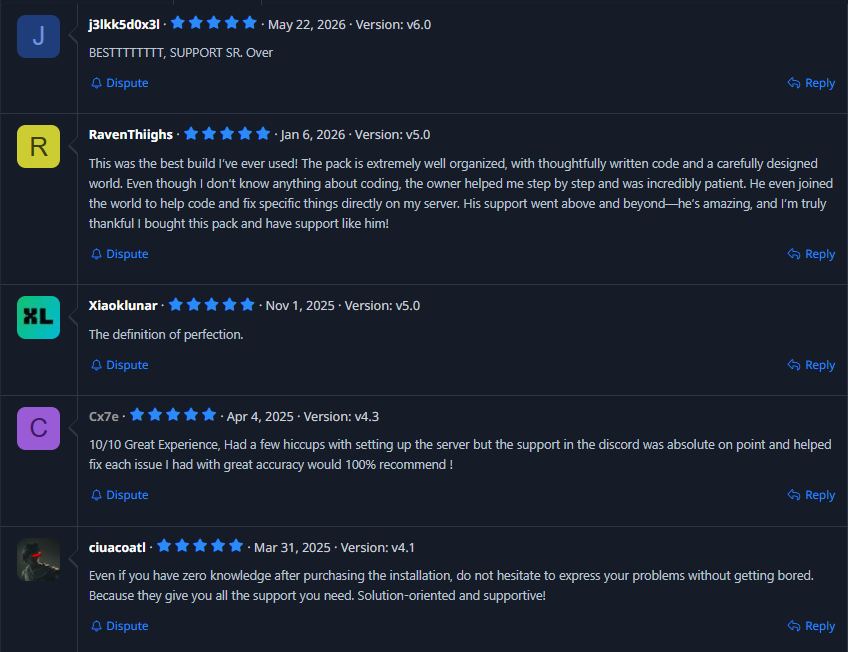
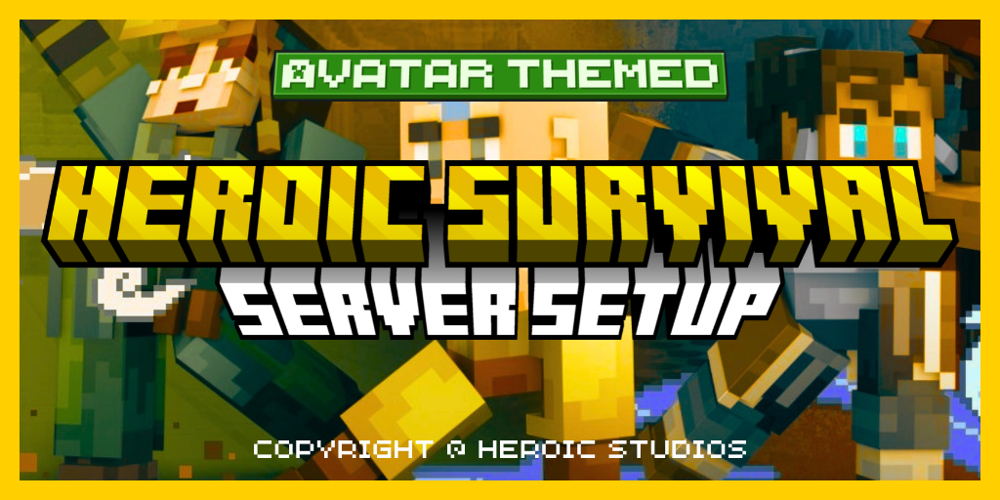
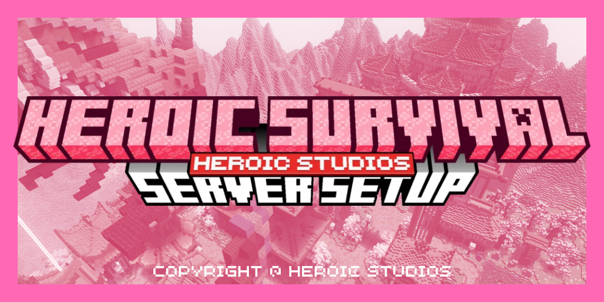
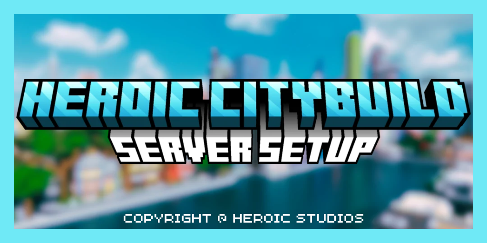
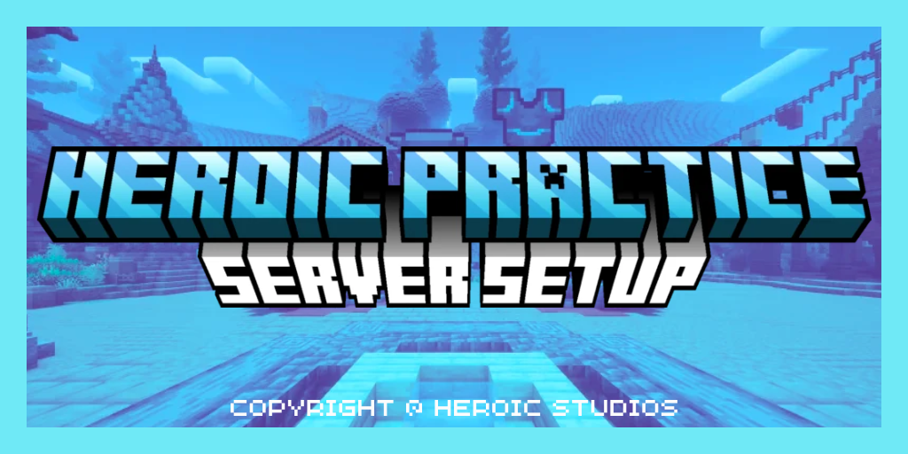
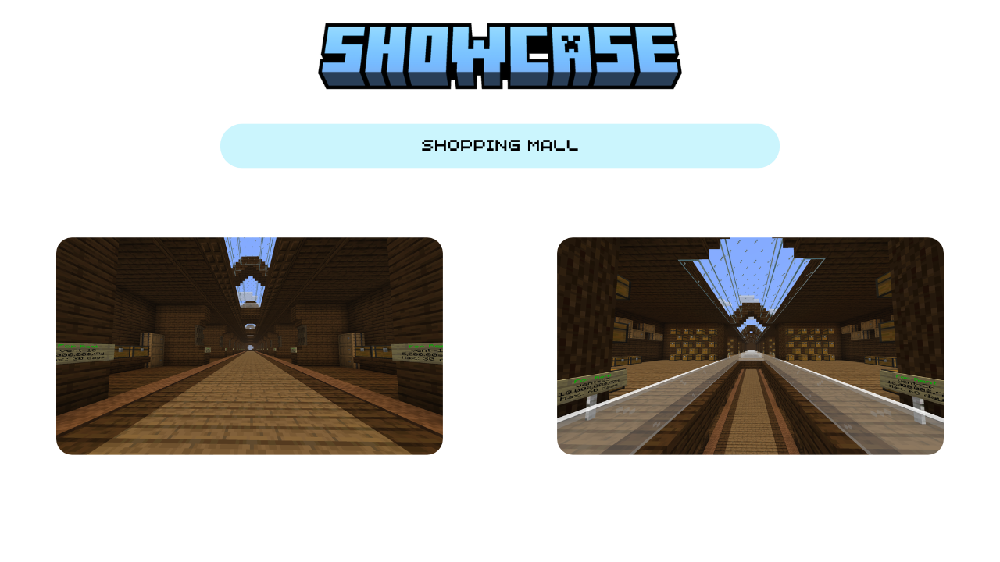
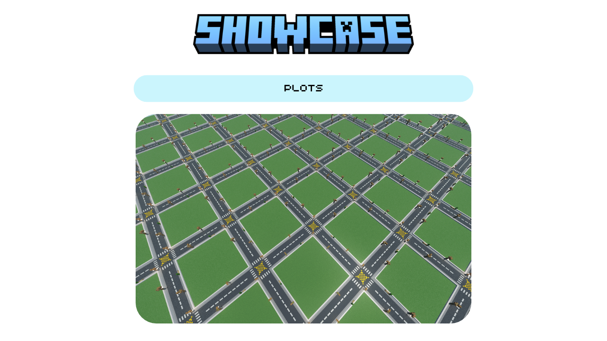
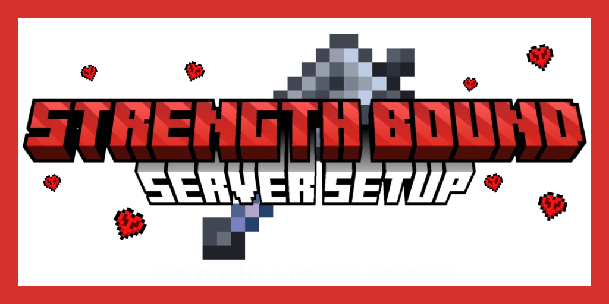
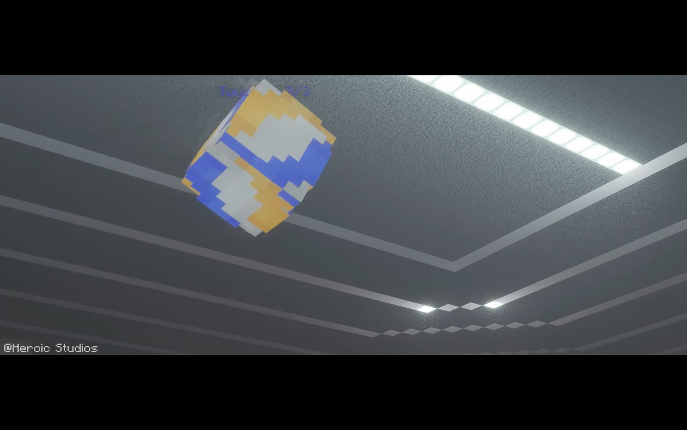

  <b>Java & Minecraft plugin developer · Founder of Heroic Studios · 60,000+ downloads</b>

  
  
  
  

---

## 🙋‍♂️ About Me

I'm an 18-year-old developer focused on **backend systems, Minecraft plugin development and server development**, with **5+ years** of experience on public Minecraft servers and private SMPs.

I'm the founder of **Heroic Studios**, a Minecraft development community that creates and sells server-side plugins, mods, complete server setups and configuration packages. Our goal is simple: resources that are **easy to access, simple to install and fun to use**.

I'm currently expanding into **game development with Godot**.

## 📊 Heroic Studios in Numbers

Over 3+ years of building and releasing resources:

| 📦 Free setup downloads | 🔌 Plugin downloads | 💰 Paid setup purchases |
| :---: | :---: | :---: |
| **60,000+** | **2,000+** | **200+** |

Across BuiltByBit, Polymart, Modrinth and McSets.

## 🛠️ Featured Projects

| Project | What it does |
| --- | --- |
| [**HeroicVolleyBall**](https://github.com/ItzOverWolf/HeroicVolleyBall) | Recreates the feeling of *Haikyuu* volleyball matches in Minecraft |
| [**HeroicHollowPlayer**](https://github.com/ItzOverWolf/HeroicHollowPlayer) | Brings *Hollow Knight*-inspired features into Minecraft |
| [**HeroicBiomeCompass**](https://github.com/ItzOverWolf/HeroicBiomeCompass) | A craftable compass that tracks any biome, for a price |
| [**RealisticCrafting**](https://github.com/ItzOverWolf/RealisticCrafting) | Crafted tools and armor can come out broken, normal or enchanted |
| [**LocalDeathMessages**](https://github.com/ItzOverWolf/LocalDeathMessages) | Shows death messages only to players near where someone died |
| [**HeroicStrikeCannon**](https://github.com/ItzOverWolf/HeroicStrikeCannon) | An add-on plugin for Simple Lifesteal |

## 🚀 Tech Stack

**Main language**

**Also work with**

&nbsp;
&nbsp;
&nbsp;
&nbsp;

**Minecraft platforms**

&nbsp;
&nbsp;
&nbsp;
&nbsp;
&nbsp;

## ⭐ What Customers Say

## 🎬 Showcases

| Showcase 1 | Showcase 2 | Showcase 3 |
| :---: | :---: | :---: |
|  |  |  |

<b>📸 Screenshots</b>

| | |
| :---: | :---: |
|  |  |
|  |  |
|  |  |
|  |  |
|  |  |

